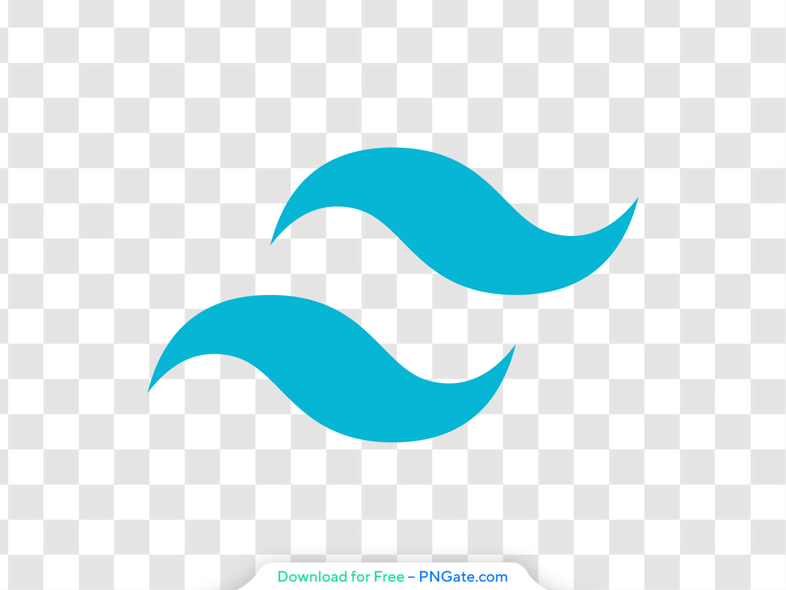
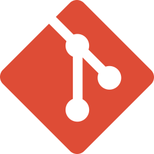
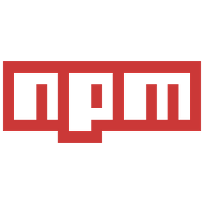

## Hi, I'm Wadim :v:

  

:gear: **I'm currently working for [leadity](https://leadity.de/) as Software Developer.**

:briefcase: **Feel free to check some examples of my code, for instance:**

**[Randomizer](https://sempris.github.io/civ_randomizer/)**

**[COVID-19 Info](https://covid19-info-sempris.netlify.app/)**

**[Movie Aggregator](https://github.com/Sempris/movie-aggregator)**

**[Bus Factor Analyzer](https://github.com/Sempris/bus-factor-analyzer)**

:hearts: **My hobbies are :computer: coding, :video_game: computer games, :game_die: tabletop games, :basketball: basketball, :ping_pong: ping-pong**

## Tools and Frameworks

             
